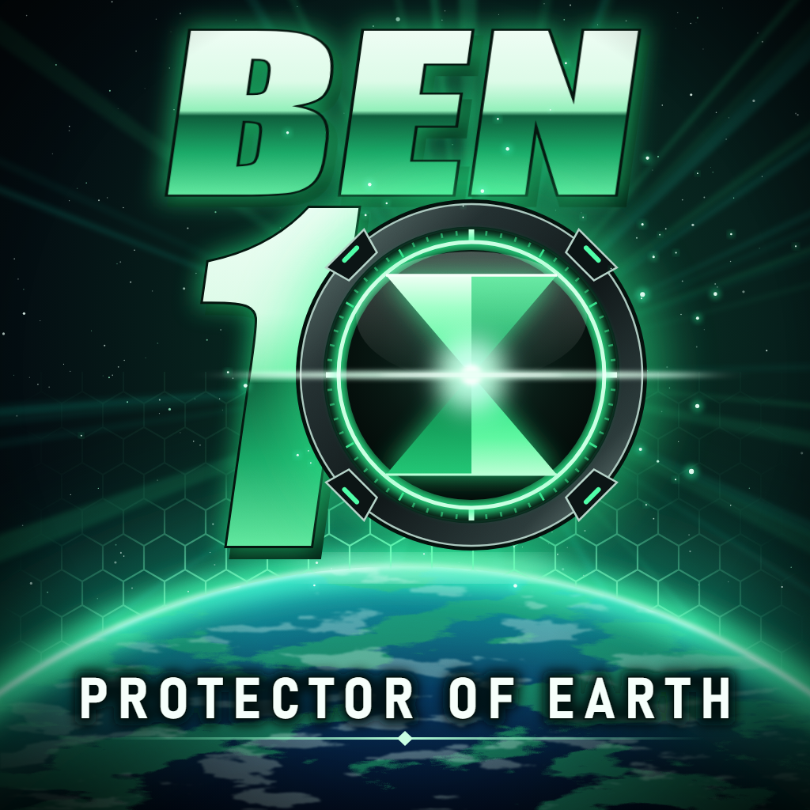

<div align=center>



</div>
<h1 align=center>Ben 10: Protector of Earth — Nintendo Switch port</h1>

A native Nintendo Switch port of the PSP version of **Ben 10: Protector of Earth** (2007).

It's not an emulator. The MIPS code of the game is statically recompiled to C with
[Nakagawa Recomp](https://github.com/Jstar269/nakagawa-recomp) and compiled for the Switch, and the game is drawn by
a native renderer on deko3d, the Switch's own GPU API. It targets **30 FPS at twice the PSP's resolution**.

> [!NOTE]
> You need your own copy of the PSP game: a disc image (`.iso`) of the edition below.

## Supported editions

| Game ID | Edition |
|---|---|
| `ULUS10307` | NTSC-U, version 1.01 |

## Status

- Handheld: about 30 FPS, with short dips in the heaviest scenes.
- Saves, closing and reopening the game, the HOME button, and powering the console off and on all work.
- Docked 1080p output is written but not yet verified on a console.
- Only part of the game has been played on this build.
- The installer is new: it has not yet run on a Windows PC from start to finish.

## How to install

On Windows 10 or 11, with about 3 GB free and your own disc image (`.iso`) of the game:

1. **[Download the installer](https://github.com/LaLemniscata/ben10-nx/releases/download/v1.0.1/Ben10-NX-Installer.zip)**
   and extract the ZIP.
2. Double-click **Install Ben 10.exe** and choose your disc image. Windows may warn about a new, unsigned
   program: choose "More info", then "Run anyway".
3. The first time, it opens the page of devkitPro, the free Switch compiler. Download devkitProUpdater, run it with
   its suggested options, then go back to the installer.
4. Wait while it builds the port: 5 to 30 minutes, depending on your computer.
5. When it finishes, type your SD card's drive letter to copy the files, or copy the `switch` folder from `output` to
   the root of the card yourself.

On the Switch, hold **R** while starting any installed game, then open **Ben 10: Protector of Earth**. Starting from
the Album has not been tested, and the CPU boost may not work there.

Nothing of the game comes with the installer. It reads your disc image and builds everything on your computer, and it
stops if the disc is not the supported edition. What it builds contains code from the game, so it is for your own
console: please do not share it. To update, download the new installer and run it again; your saves stay on the card.

Saves go to `memstick/` in the game's folder, and the log to `log.txt`.

## Controls

The face buttons match the PSP by position.

| Switch | PSP |
|---|---|
| A | Circle |
| B | Cross |
| X | Triangle |
| Y | Square |
| L / ZL | L |
| R / ZR | R |
| + | Start |
| − | Select |
| Left stick | Analog nub |
| D-pad | D-pad |

Press **+** and **−** together to quit.

## Settings

An empty file with one of these names, next to the NRO, changes how the game runs:

| File | Effect |
|---|---|
| `scale1.txt`, `scale3.txt`, `scale4.txt` | Internal render scale instead of 2 |
| `debug.txt` | Frame, GPU and save measurements in `log.txt` |
| `profile.txt` | Samples where the CPU goes into `profile.bin` |
| `noboost.txt` | Normal clocks instead of the CPU boost |
| `nogethread.txt` | The GE on the game's core |
| `notnl.txt` | Vertex processing on the CPU |
| `software.txt` | The CPU renderer |

## Resolution

The game renders at 960x544, twice the PSP's 480x272, and is shown at 1280x720 in handheld mode and 1920x1080 docked.
If the GPU falls behind for a few seconds in a row, the render scale steps down by itself and says so in the log.

## Performance

The port asks the system for its official CPU boost mode, not an overclock:

| Mode | CPU | GPU |
|---|---|---|
| Handheld and docked | 1785 MHz | 76.8 MHz |

Measured in about 17 minutes of handheld play, in 5-second samples: 186 of 203 between 28 and 31 FPS, 9 below 28, and
a lowest sample of 22 FPS. GPU time was about 20 ms per frame.

## How it works

- **The game's code is translated, not emulated.** Nakagawa Recomp translates the game's program to C, which is then
  compiled for the Switch. Its runtime gives the game what it expects from a PSP: its system, files, audio and
  controllers. This port adds the Switch part: threads, files on the SD card, audio output, input and clocks.
- **Its own renderer.** The GE's draws become deko3d commands, with mip levels and vertex processing on the GPU. The
  states most pixels use run a short fragment shader, because the GPU is at its lowest clock in the boost mode.
- **The GE on its own core.** As on a PSP, display lists run on a separate thread while the game goes on.
- **Optimization.** Guest registers stay in local variables, floating-point operations skip the environment switch
  when the game does not need it, and a sampling profiler can give the linker a function order.

## Build by hand

The installer does all of this. These steps are for working on the port itself. You need devkitPro with `switch-dev`
and `deko3d`, Python, and your own copy of the game. The translated C and the NRO contain code from the game, so they
are not part of this source tree.

1. Get the full project, which holds the translator and the desktop player that prepares the game's package:

   ```bash
   git clone https://github.com/Jstar269/nakagawa-recomp
   cd nakagawa-recomp
   git checkout 70b1d3f8
   ```

   Build the player as its `docs/SETUP.md` describes, add your disc image to its library, and let it build the package.

2. In that clone, translate the game again with register promotion, into a new private folder. The package's
   `codegen_profile.json` lists the `--extra-elf` arguments in `EXTRA_ELF_ARGS`.

   ```bash
   python tools/codegen.py <selected.elf> <out>/experimental-ulus10307_recomp.c --base=0x08804000 \
     --funcs-per-chunk=2000 --target-chunk-bytes=4000000 --promote-registers <EXTRA_ELF_ARGS>
   ```

   Then copy the package's `*.h` files that are not already in `<out>`.

3. In this repository, from WSL or Linux:

   ```bash
   export DEVKITPRO=/opt/devkitpro
   make -f Makefile.switch -j6 PACKAGE_DIR=<out>
   ```

   `Makefile.switch` has no header dependencies: after changing a header or a flag, remove `build_switch/src` and
   `build_switch/gen` first.

| Folder | Contents |
|---|---|
| `src/rt/switch/` | The port: entry point, renderer and shaders, GE thread, audio, input, file calls, profiler, cover art |
| `src/rt/`, `src/core/` | The parts of Nakagawa Recomp's runtime the port uses |
| `installer/` | The installer and the script that packs its release |
| `assets/vfpu/` | Runtime tables for the PSP's vector unit |

## Changes to Nakagawa Recomp

Based on commit `70b1d3f8`, with changes made in November 2026. This repository keeps only the files the Switch build
uses; the full project, with its tests, tools and documentation, is [upstream](https://github.com/Jstar269/nakagawa-recomp).

| File | Change |
|---|---|
| `src/rt/hle_kernel_sync.c` | First-come semaphore hand-off, which fixes a starved audio thread at a loading screen |
| `src/rt/fp_convert.h` | On the Switch, guest float operations in round-to-nearest skip the FP environment switch |
| `src/rt/recomp.h` | On the Switch, a cheaper time-slice count and no store-watch check |
| `src/rt/sched.c` | A longer time slice on the Switch |
| `src/rt/sr_coro.c` | Main stack bounds on the Switch |
| `src/rt/ge.c`, `src/rt/hle.c`, `src/rt/hle_ge.c`, `src/rt/hle_internal.h` | Display lists run on the GE thread |

## Credits

- **High Voltage Software and D3 Publisher** — creators of Ben 10: Protector of Earth. This is an unofficial, fan-made
  port with no affiliation.
- **[Nakagawa Recomp](https://github.com/Jstar269/nakagawa-recomp)** — the recompiler and runtime this port is built on.
  Its notices are in [`NOTICE.md`](NOTICE.md) and [`CREDITS.md`](CREDITS.md).
- **devkitPro and switchbrew** — devkitA64, libnx and deko3d.

## Legal

No affiliation with Cartoon Network, D3 Publisher or Nintendo. "Ben 10" is a trademark of its owners. This repository
contains no assets or program code from the original game. Users must provide their own legally obtained copy. The
cover art is original and uses no art from the game; the name and the symbol it reinterprets belong to their owners.
Running homebrew requires custom firmware, which violates Nintendo's ToS and can get a console banned — your call.

Source code is provided under the GPL-3.0-or-later license (see [`LICENSE`](LICENSE)), inherited from Nakagawa Recomp.
Third-party code keeps its own licenses: see [`THIRD_PARTY_LICENSES`](THIRD_PARTY_LICENSES).
